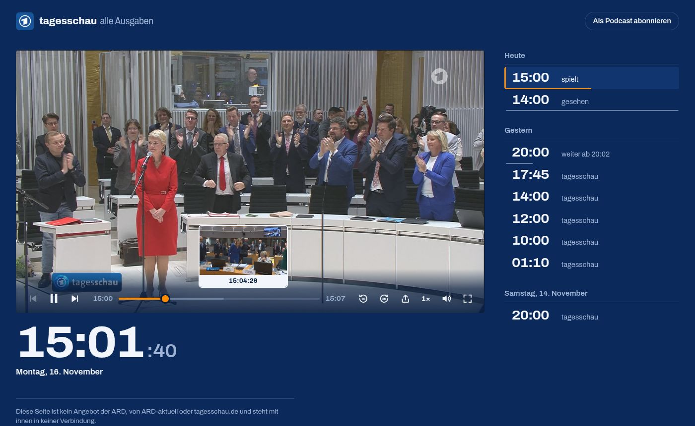
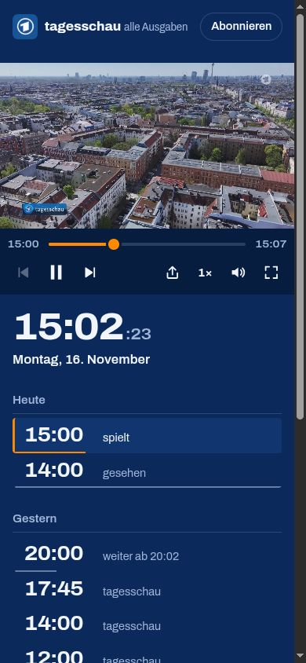

<p align="center">
  
</p>

<p align="center">
  <a href="https://nixbot.brkn.lol/repos/github/pschmitt/tagesschau"></a>
</p>

<h1 align="center">tagesschau</h1>

<p align="center">
  Every tagesschau edition as a podcast feed and a web player, plus the
  edition on air from its first second.
</p>

<p align="center">
  
  
</p>

The official tagesschau podcasts carry the 20:00 edition only. tagesschau.de
publishes every regular edition (12:00, 14:00, 17:00, 20:00, ...) as an MP4
about 15 minutes after it aired. This small server lists them, plays them and
replays the edition on air from its start. It stores no video: everything
plays from ARD's servers.

## Features

- **Podcast feed**: the editions of the last 48 hours, newest first, in 1080p,
  as RSS for any podcast app.
- **Web player**: starts the newest edition, shows the playhead in broadcast
  time, remembers positions, seeks with thumbnails and double taps, and shares
  links to a moment.
- **Time-shifted live stream**: `/live` returns an HLS stream of the edition
  on air (or aired in the last 90 minutes) that starts at its first second, cut
  from Das Erste's two-hour live window.
- **NixOS module**: `services.tagesschau`, with a hardened systemd unit.
- **Android app**: a native player with picture-in-picture, downloads, a Tasker
  plugin and self-updates; see [docs/android.md](docs/android.md).

This project is not affiliated with the ARD, ARD-aktuell or tagesschau.de. The
logo and the screenshots show ARD material; the logo is loaded from ARD's own
image server and is not part of this repository.

## Install

Add the flake and enable the module:

```nix
{
  inputs.tagesschau.url = "github:pschmitt/tagesschau";
  # in your NixOS configuration:
  imports = [ inputs.tagesschau.nixosModules.default ];
  services.tagesschau = {
    enable = true;
    baseUrl = "https://tagesschau.example.com";   # public URL behind your proxy
  };
}
```

See [docs/nix.md](docs/nix.md) for every option.

On Android, install the app from the
[`latest` release](https://github.com/pschmitt/tagesschau/releases/tag/latest);
see [docs/android.md](docs/android.md).

## Quick start

```sh
nix run github:pschmitt/tagesschau                # listens on 127.0.0.1:8089
curl -s localhost:8089/feed.xml | head -c 300      # the podcast feed
xdg-open http://localhost:8089/                    # the web player
curl -s localhost:8089/live/audio                  # stream URL of the edition on air
```

Subscribe to `/feed.xml` in a podcast app, or open `/` in a browser.

## Documentation

| Topic | |
| --- | --- |
| [NixOS module](docs/nix.md) | Options, reverse proxy, artwork |
| [HTTP interface](docs/http.md) | Feed, player, live stream and JSON endpoints |
| [Android app](docs/android.md) | Native player, downloads, Tasker, self-update |

## License

[GPL-3.0-or-later](LICENSE).
